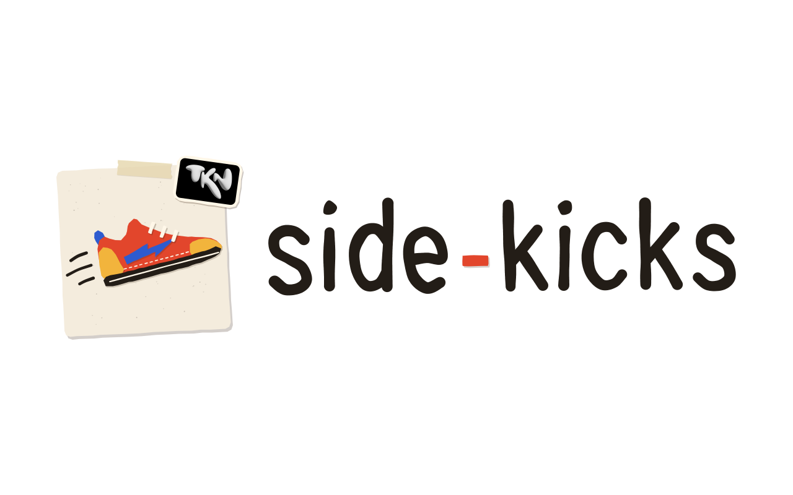

<p align="center">
  <picture>
    <source media="(prefers-color-scheme: dark)" srcset="docs/brand/side-kicks-logo-dark.svg">
    
  </picture>
</p>

# Side-Kicks

> **Home of [Limitless MCP for Figma](figma-limitless-mcp/)** — a local Figma MCP server + Desktop plugin that gives AI assistants full, unthrottled Figma access *and* a built-in design-system knowledge layer + 57-rule structure linter.


-2ea44f)


📖 **AI builders start here:** [AGENTS.md](AGENTS.md) — workspace-level canonical rules.
🏷️ **Latest releases:** [Natural Scroll Switch 1.0.0](https://github.com/tknatwork/side-kicks/releases/tag/natural-scroll-switch-v1.0.0) (17 Aug 2026) · [Limitless MCP for Figma 0.4.0](https://github.com/tknatwork/side-kicks/releases/tag/figma-limitless-mcp-v0.4.0) (9 Aug 2026) — motion variables, MP4/GIF/WEBM export, 57-rule DS linter. `main` carries Limitless 0.5.1 (not yet released).
🔒 **Reporting a vulnerability:** [`.github/SECURITY.md`](.github/SECURITY.md).
🐛 **Reporting a bug:** [Open an issue](https://github.com/tknatwork/side-kicks/issues/new/choose).

---

## 🚀 Flagship — Limitless MCP for Figma

**[`figma-limitless-mcp/`](figma-limitless-mcp/)** — everything the official/remote Figma MCP can't reach, running entirely on your machine: your locally-installed fonts, variable/component/prototype authoring (incl. motion `EASING`/`TIMING` variables), MP4/GIF/WEBM export of animated frames, the FigJam/Slides/Buzz surfaces, a crash-safe journal/checkpoint session layer, and a **build → lint → fix** design-system loop (bundled skills + a 57-rule structure linter). No REST calls, no REST rate limits (it uses the local Plugin API), no plan-tier tooling locks. **106 tools, v0.5.1.**

→ **[Read the full docs & quick start](figma-limitless-mcp/README.md).**

*Independent project — not affiliated with, endorsed, or sponsored by Figma. "Figma" is used descriptively (a tool "for Figma"). It's a local/private developer tool and is not distributed via Figma Community.*

## Also in this repo

| Project | Folder | Status |
|---------|--------|--------|
| figma-to-indesign | [`figma-to-indesign/`](figma-to-indesign/) | v0.1 (9 Aug 2026) · MCP toolset — Figma → editable InDesign (.indd/.idml) without PDF: original bitmaps, live text, CMYK/sRGB, PDF/X-1a, verified hand-off package. macOS only; pairs with Limitless MCP **≥ 0.4.0**. |
| Variables & Styles Extractor | [`variables-styles-extractor/`](variables-styles-extractor/) | Published v2.2.0 (first published 17 Jan 2026) · Figma plugin — export/import Figma variables & styles as JSON (Figma · Tokens Studio · W3C). [Community page](https://www.figma.com/community/plugin/1584331992332668732/variables-and-styles-extractor) |
| Natural Scroll Switch | [`natural-scroll-switch/`](natural-scroll-switch/) | v1.0.0 (17 Aug 2026) · macOS utility — natural scrolling follows the device in your hand: OFF for a third-party mouse, ON for trackpads and Apple Magic devices. One-click app, universal binary (arm64 + x86_64), no permissions, no network. macOS 12+. |

---

## Repository layout

```
side-kicks/                                     (this repo: tknatwork/side-kicks)
├── AGENTS.md                       ← Workspace AI rules (canonical)
├── CLAUDE.md                       ← Pointer to AGENTS.md (legacy Claude Code path)
├── README.md                       ← This file
├── .github/
│   ├── CODEOWNERS                  ← Auto-review routing
│   ├── SECURITY.md                 ← Vulnerability disclosure policy
│   ├── dependabot.yml              ← Update policy
│   ├── ISSUE_TEMPLATE/             ← Bug + feature templates
│   ├── copilot-instructions.md
│   └── workflows/
│       ├── codeql.yml              ← Security scanning (JS/TS only)
│       ├── natural-scroll-switch-ci.yml       ← copies of natural-scroll-switch/ci/*
│       └── natural-scroll-switch-release.yml  ← (that folder is the source of truth)
├── .gcc/                           ← Workspace session memory + build log (local only — gitignored)
│   ├── session-memory.md
│   ├── commit.md
│   ├── metadata.yaml
│   ├── main.md
│   ├── memory.md
│   └── changelog.md
├── docs/
│   ├── CHANGELOG.md                ← Workspace-level changelog (PROTECTED)
│   └── brand/                      ← Logo, mark, Finder folder icon — all generated by build.mjs
├── variables-styles-extractor/     ← Project: Figma plugin
│   ├── AGENTS.md                   ← Project AI rules (canonical)
│   ├── CLAUDE.md                   ← Pointer to project AGENTS.md
│   ├── README.md                   ← Public-facing plugin docs
│   ├── LICENSE                     ← MIT + Figma CFRL distribution notice
│   ├── manifest.json               ← Figma plugin manifest
│   ├── code.js                     ← Compiled output (CHECKED IN — no CI builds it)
│   ├── ui.html                     ← UI source
│   ├── src/code.ts                 ← Backend source (Figma QuickJS VM)
│   ├── .gcc/                       ← Project session memory + build log
│   ├── START_HERE.md               ← Boot check (constraints, build, danger zones)
│   ├── assets/                     ← Plugin logo (SVG) + icon
│   ├── .github/copilot-instructions.md
│   └── docs/                       ← CHANGELOG, CODING_STANDARDS, FIGMA_PLUGIN_DEVELOPMENT, etc.
├── figma-limitless-mcp/            ← Project: local Figma MCP (server + plugin)
│   ├── AGENTS.md                   ← Project AI rules (canonical)
│   ├── CLAUDE.md                   ← Pointer to project AGENTS.md
│   ├── README.md                   ← Public-facing docs (install, AI usage, tools)
│   ├── LICENSE.md                  ← MIT
│   ├── server/                     ← MCP server (TypeScript → dist/, built locally)
│   ├── plugin/                     ← Figma Desktop plugin (TypeScript/React → dist/)
│   ├── scripts/e2e-live-test.mjs   ← Live end-to-end tool suite
│   ├── docs/                       ← AI-GUIDE (operating rules for AI sessions)
│   └── .gcc/                       ← Project session memory + build log
├── figma-to-indesign/              ← Project: Figma → editable InDesign MCP toolset (macOS)
│   ├── AGENTS.md                   ← Project AI rules (canonical)
│   ├── CLAUDE.md                   ← Pointer to project AGENTS.md
│   ├── README.md                   ← Public-facing docs (pipeline, hand-off package)
│   ├── LICENSE.md                  ← MIT
│   ├── server/server.py            ← MCP server (Python)
│   ├── pipeline/                   ← Python conversion steps + jsx/ InDesign scripts
│   └── docs/                       ← SPEC, WINDOWS (why Windows is unsupported)
└── natural-scroll-switch/          ← Project: macOS natural-scrolling switcher (Swift)
    ├── AGENTS.md                   ← Project AI rules (canonical)
    ├── CLAUDE.md                   ← Pointer to project AGENTS.md
    ├── README.md                   ← Public-facing docs (install, config, limits)
    ├── LICENSE.md                  ← MIT
    ├── CHANGELOG.md                ← Keep a Changelog
    ├── VERSION                     ← Single source of truth for the version
    ├── Package.swift               ← SwiftPM: CLI/daemon + installer app products
    ├── Sources/                    ← NaturalScrollSwitch (daemon) + …App (AppKit front end)
    ├── scripts/                    ← build-app.sh (universal .app + dmg), make-icon.swift
    ├── ci/                         ← Source of truth for the two root workflows
    └── docs/HOW-IT-WORKS.md        ← Mechanism + the approaches that do not work
```

---

## AI documentation pattern

This workspace uses the [Sourcegraph AGENTS.md convention](https://agents.md):

| Layer | Canonical file | Pointer |
|-------|----------------|---------|
| Workspace | `AGENTS.md` (this folder) | `CLAUDE.md` (this folder) |
| Project | `<project>/AGENTS.md` | `<project>/CLAUDE.md` |

All builder LLMs (Claude Code, Cursor, Copilot, Aider, Continue, Gemini CLI, Codex) read `AGENTS.md`. `CLAUDE.md` exists at the same paths as a pointer for legacy Claude Code lookups and tooling that hardcodes the older path.

**Read order at session start:**
1. Workspace [`AGENTS.md`](AGENTS.md) — what this repo is, project scope rules, security posture
2. Workspace `.gcc/session-memory.md` — warm-start state (local only — `.gcc/` is gitignored)
3. Per-project `AGENTS.md` (when working inside a project folder)
4. Per-project `.gcc/session-memory.md`

---

## Protected files

Some paths capture context that other tooling depends on. **Never delete — rewrite if the content becomes wrong.**

### Workspace-level
- `AGENTS.md`, `CLAUDE.md`, `README.md`
- `.github/SECURITY.md`, `.github/CODEOWNERS`, `.github/dependabot.yml`
- `.gcc/*` (six files)
- `docs/CHANGELOG.md`

### Per-project
- `<project>/AGENTS.md`, `<project>/CLAUDE.md`
- `<project>/README.md`, `<project>/LICENSE`
- `<project>/.gcc/*` (six files)
- `<project>/.github/copilot-instructions.md` (where present)
- `<project>/docs/CHANGELOG.md`
- Any path that became a redirect during a structure change (e.g. `<project>/docs/AGENTS.md` → redirect to project root after 2026-05-22)

---

## Security

- **Visibility:** Public repository. Anyone can clone or fork; only collaborators with write access can push.
- **Branch protection on `main`:** PR required + Code Owner review + CodeQL must pass + linear history + no force-push + no deletion.
- **Vulnerability reporting:** [`.github/SECURITY.md`](.github/SECURITY.md). Use [GitHub Private Vulnerability Reporting](https://github.com/tknatwork/side-kicks/security/advisories/new) — do not file public issues for security bugs.
- **Bug + feature reporting:** [GitHub Issues](https://github.com/tknatwork/side-kicks/issues/new/choose).
- **Automated scanning:** Dependabot alerts + security updates + secret scanning + push protection + CodeQL.

---

## Adding a new project

```bash
mkdir -p "Side-Kicks/<project-name>"/{.github,.gcc,docs,src}
cd "Side-Kicks/<project-name>"

# Required at project root:
#   AGENTS.md          — canonical project AI rules
#   CLAUDE.md          — pointer to AGENTS.md
#   README.md          — public-facing
#   LICENSE            — project license
#   .gcc/              — six files (session-memory, commit, metadata, main, memory, changelog)
#
# Optional:
#   docs/              — additional documentation (CODING_STANDARDS, KNOWN_ISSUES, etc.)
#   src/               — source code
```

Then update:
1. This README's "Also in this repo" table and "Repository layout" tree.
2. Workspace [`AGENTS.md`](AGENTS.md) "What this repo is" table.
3. Workspace `.gcc/main.md` "Sub-projects" table (local only).

---

## Brand

The Side-Kicks logo is a cut-paper sneaker seen from the side — a *side kick* — taped to a card beside
marker lettering. Everything in [`docs/brand/`](docs/brand/) is generated by
[`build.mjs`](docs/brand/build.mjs) (Node, no dependencies) from a seeded PRNG, so the hand-made wobble
is reproducible.

| File | Use |
|------|-----|
| `side-kicks-logo.svg` · `-dark.svg` · `.png` | The header above — 16:10 canvas, light + dark |
| `side-kicks-mark.svg` · `.png` | Square mark (avatars, social preview) |
| `side-kicks-folder.svg` · `.png` · `.icns` | Finder folder icon, with the TKN logo as a sticker |
| `side-kicks-folder-16x10.svg` · `.png` | The folder art on a 16:10 canvas |
| `tkn-logo.jpg` | The TKN logo the sticker embeds (cropped 3:2 from the master) |

```bash
node docs/brand/build.mjs          # SVGs
node docs/brand/build.mjs --png    # + PNGs and the .icns (macOS; renders with Google Chrome)
```

**Folder icon:** Get Info on the folder → drag `side-kicks-folder.icns` onto the small icon at the top
left. Finder writes a hidden `Icon\r` file into the folder; `.gitignore` already ignores it.

---

## Related folders

| Folder | Relationship |
|--------|--------------|
| My Portfolio | Independent |
| Research Study | Independent |

---

*Last updated: 2026-11-03 (hand-built logo + Finder folder icon in `docs/brand/`; figma-to-indesign added to the layout; VSE 2.2.0; latest releases) · 2026-07-15 (repositioned MCP-first — Limitless MCP for Figma is the flagship)*
